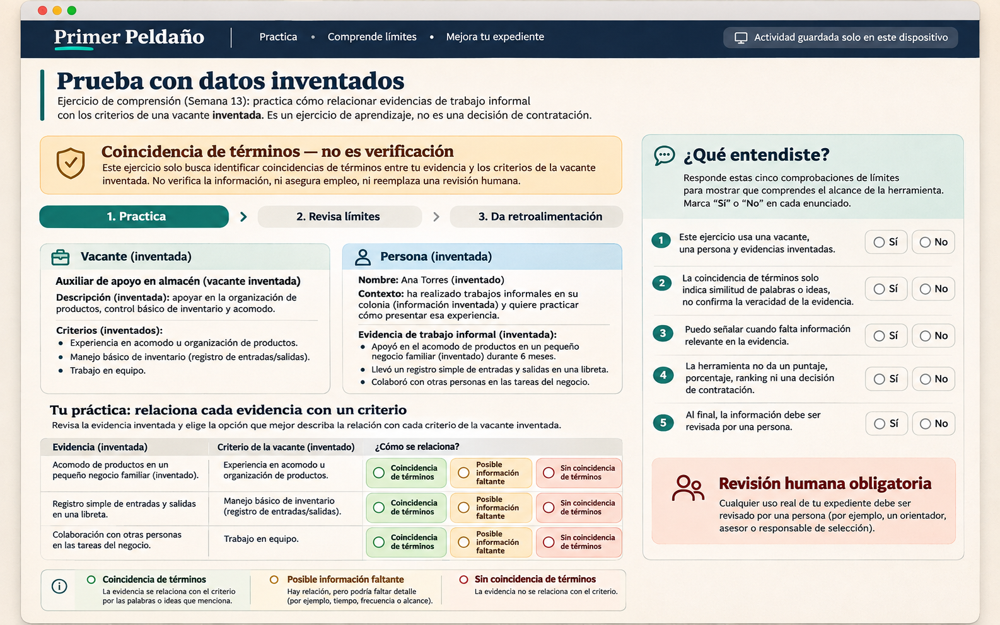
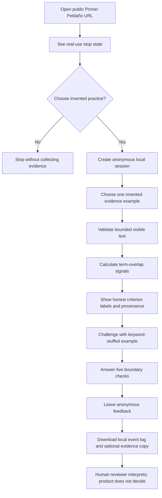
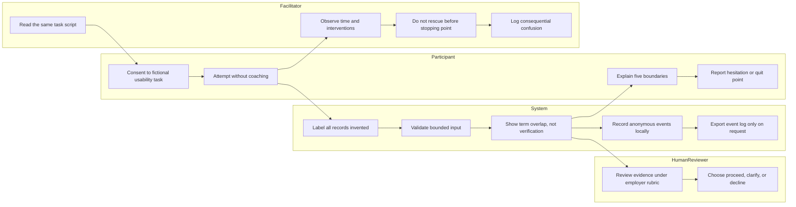

# Week 13 Venture Packet - Primer Peldaño

## Packet before code

This packet defines the Week 13 slice before any Week 13 product code is changed. It translates the Week 13 Operator brief and three-founder Blueprint into one testable build for Primer Peldaño. It also applies David's manifesto: expand opportunity without abandoning health, truth, worker agency, or the relationships the venture is intended to strengthen.

## Problem in my words

The current demo can organize visible words into criterion-level signals, but a green state can still look more authoritative than it is. Five positive reactions would not prove that a worker understands the product or that an employer would accept the evidence. The Week 13 problem is to observe whether outsiders can complete one invented task and explain the product's limits without coaching, especially when a deliberately keyword-stuffed example tempts them to mistake term overlap for verified or sufficient evidence.

## Exact user

The product user remains an experienced worker in Mexico whose useful work is overlooked because it came from an informal, unfamiliar, or uncertified setting. The Week 13 test participant is a relevant outsider who did not build the product: a worker, job seeker, hiring manager, recruiter, workforce practitioner, or community educator who can attempt the same fictional task. At least three of the five participants must be strangers to David; friends-and-family-only testing is forbidden.

## Success definition

Before the Week 13 module closes, the public URL must let an outsider complete one invented evidence-mapping task in ten minutes or less, confront a keyword-stuffed counterexample, answer five comprehension checks, leave anonymous structured feedback, and download the local event log. Without coaching, each participant must explain that the vacancy and records are invented, a term match is not verification or sufficiency, the file stays on the device unless the worker shares it, a human decides, and no employer receives anything automatically.

Five sessions can expose usability failures; they cannot establish employer demand, worker benefit, evidence truth, a 10:1 improvement, or a hiring outcome. One belief that the system sent a file or verified evidence triggers a fix and retest even if the participant says they like the product.

## Image-generated mockup

The direction-setting image below was generated before Week 13 implementation. It is a design hypothesis, not evidence that the feature works. The final interface may differ after testing, but it must preserve the honest term-match language, the five comprehension boundaries, local-only activity log, and human-review authority.

## Feature flow

## Actor swimlane

## Benchmark line

**Best existing solution on Earth:** Opportunity@Work's STARs ecosystem is the strongest benchmark for changing employer demand because it helps employers recognize workers Skilled Through Alternative Routes and shift from pedigree screens toward skills-first hiring.

**How Primer Peldaño differs or localizes:** Primer Peldaño narrows that systemic change to one Mexico-localized, vacancy-specific preflight: the employer must accept named evidence before the worker invests effort, the worker controls sharing, and the interface labels text overlap as neither verification nor sufficiency.

CONOCER is the local certification comparator, not a feature to imitate lightly: it recognizes competencies acquired formally, informally, or empirically through declared standards, authorized evaluation, evidence, and a human certification process. Primer Peldaño does not certify or replace CONOCER; it tests whether one employer will consider existing evidence for one opening before a longer application or certification process.

Primary references:

- [Opportunity@Work - Who are STARs?](https://www.opportunityatwork.org/stars)
- [Opportunity@Work - STARs Hiring Playbook](https://www.opportunityatwork.org/take-action/psh/public-sector/stars-hiring-playbook)
- [CONOCER - How to certify competencies](https://conocer.gob.mx/certifico-mis-competencias/)
- [CONOCER - Frequently asked questions](https://conocer.gob.mx/preguntas-frecuentes/)

## Three-year long view

If this slice works, Primer Peldaño becomes shared infrastructure through which employers, universities, and community organizations translate existing informal work into worker-controlled evidence for real openings. Employers publish reusable criteria and acceptance commitments while independent reviewers audit quality, appeals, labor treatment, queue capacity, and 90-day employment outcomes. The venture succeeds only if it expands mobility without turning candidates into unpaid test workers, hiding uncertainty, or reducing people to opaque scores.

## Scope cut

This week does not build a job board, CV generator, candidate marketplace, credential, certification, identity check, background check, automated hiring decision, employer inbox, reviewer dashboard, production AI, new work sample, or real application flow. It does not collect real personal data, transmit records to an employer, claim a real vacancy, or claim five completed sessions before they occur. It does not prove a 10:1 result; all five-user findings remain descriptive and are reported with failures, withdrawals, missing data, participant relationship, and interventions.

## Shadow clause

- A voluntary test must not become an implied hiring requirement.
- Every session uses fictional records and has no hiring consequence.
- A future real-vacancy pilot must preserve the existing application path with the same deadline, consideration, and review standard.
- The hiring manager never receives research behavior, completion time, feedback, or the decision to participate.
- The system must not present a fictional employer as a real opportunity or a term match as verified evidence.
- The user bears no hidden upload, unpaid work sample, or automatic data transfer.

## Architecture and free stack

| Layer | Choice | Week 13 boundary |
|---|---|---|
| App | Next.js 16 + React 19 + TypeScript | One responsive public flow with semantic HTML and keyboard support. |
| Styling | Tailwind CSS 4 | Existing editorial design system; high-contrast status language that does not rely on color alone. |
| Mapping | Deterministic TypeScript | Visible term-overlap signals only; no verification, score, rank, or model inference. |
| Analytics | Browser `localStorage` event log | Anonymous session ID, event name, timestamp, and bounded metadata; no names, contact details, evidence text, or cross-device tracking. |
| Feedback | Local structured form | Five comprehension checks, task verdict, optional 240-character note, relationship category, and consent; downloadable JSON, never automatically sent. |
| Data | No production database | Supabase remains disabled for the public demo; no personal information is accepted or stored. |
| Hosting | Vercel | Dedicated Week 13 project and public URL, separate from Week 12. |
| Source | Dedicated GitHub repository | At least five ordered Week 13 commits, separate from the Week 12 repository. |

## Event schema

The local log may record only: `session_started`, `demo_opened`, `example_selected`, `mapping_completed`, `provenance_opened`, `boundary_answered`, `adversarial_verdict`, `feedback_submitted`, `log_downloaded`, and `session_reset`. Every event contains an anonymous random session ID, ISO timestamp, event name, and allow-listed categorical metadata. It must never include evidence text, free-text feedback, IP address, device fingerprint, email, phone, name, employer name, or browser identifiers.

## Five-user session protocol

1. Recruit five relevant outsiders; mark each relationship honestly and require at least three strangers.
2. Obtain consent for a fictional usability exercise and explain that no job or employer receives the result.
3. Give every participant the same uncoached task and ten-minute stopping point.
4. Permit one neutral repetition of the task after five minutes. Pointing, defining product labels, or correcting a misconception counts as an intervention and a failed unassisted pass.
5. Record completion time, interventions, whether the participant identified the keyword-stuffed example as insufficient, each of the five boundary explanations, hesitation, quit point, and consequential misunderstanding.
6. Report all outcomes, including withdrawals and missing data. Separate worker-side usability observations from employer-commitment interviews.
7. Fix the highest-consequence recurring confusion, deploy again, and retest the relevant step.

## Test plan

### Mechanical pass

1. Unit-test input limits, sensitive-pattern blocking, deterministic mapping, honest status reasons, portable export, local event allow-list, feedback validation, and absence of aggregate scores.
2. Add a contract test that fails if `Sustentado` returns to the interface or if analytics capture evidence/free text.
3. Run tests, type checking, lint, production build, and a tracked-secret scan.
4. Deploy the first Week 13 release to its dedicated Vercel project and verify the anonymous public URL on desktop and 390 x 844 mobile.
5. Complete the scripted task, find at least one real defect, document it, fix it, rerun checks, and redeploy.

### Real-human pass

Run the five-user protocol above. A session passes only when the participant completes the task within ten minutes and explains all five boundaries without coaching. Praise is not a pass condition. A dangerous misunderstanding is higher priority than positive sentiment and requires a fix and targeted retest.

### Persona pass

Use a fresh independent chat with an invented mid-career worker who reads slowly on a phone, uses WhatsApp, distrusts hiring platforms, and quits when data sharing is unclear. Show screenshots in order, record every hesitation, fix the highest-severity confusion, and preserve the transcript. Label the result synthetic; it cannot substitute for the five real users.

## Acceptance criteria

- All public records and the employer commitment are visibly labeled invented.
- The real-use state remains blocked until a documented employer commitment exists.
- `Sustentado` does not appear; criterion labels are `Coincidencia de términos`, `Posible información faltante`, and `Sin coincidencia de términos`.
- Every result states that term overlap is not verification or sufficiency.
- The keyword-stuffed example can produce overlap but the interface still requires a human sufficiency verdict.
- The visitor can answer all five comprehension checks and cannot submit an incomplete set.
- The feedback form uses bounded anonymous fields and an explicit consent checkbox.
- Analytics remain local, minimize metadata, and can be inspected, downloaded, and reset by the visitor.
- No event contains evidence text or free-text feedback.
- No global score, match percentage, ranking, recommendation, certification, or hiring prediction appears.
- The public URL loads anonymously and the final tested release is the deployment of record.

## Commit and deploy sequence

1. Import the Week 12 source into a new Week 13 repository without modifying the old repository.
2. Commit this packet, mockup, implementation prompt, and charter addendum before Week 13 code.
3. Commit honest term-match language and the adversarial example.
4. Commit local event logging, comprehension checks, and anonymous feedback.
5. Commit automated tests and first-deploy evidence.
6. Commit the highest-severity test fix and second-deploy evidence.
7. Commit final decision log, five-user/persona evidence available at that time, and submission PDFs.
